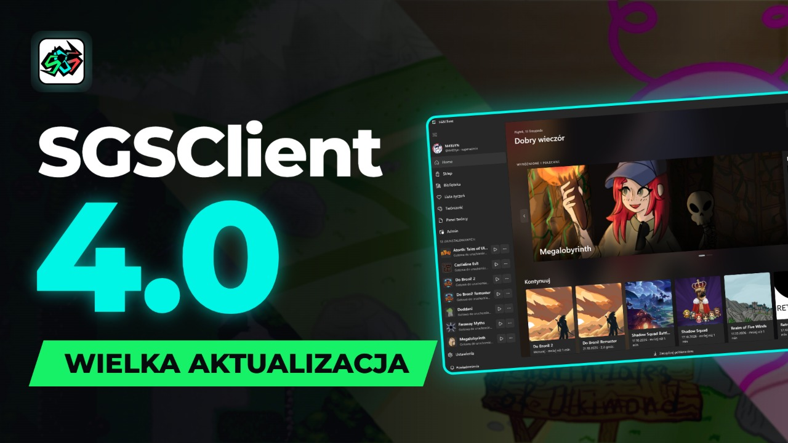

# SGSClient

Klient sklepu i biblioteki gier oraz API katalogu, oparte na .NET 10. Dwie powłoki desktopowe (Avalonia, WinUI 3) współdzielą ViewModele. Interfejs jest po polsku.

[](https://youtu.be/Tn1czMhqsKs)

- **Dla graczy, twórców i deweloperów:** [dokumentacja](https://sgs.m455yn.io/docs/)
- **Jak opublikować grę:** [przewodnik](docs/creators/how-to-publish.md) i [szablon do pobrania](https://github.com/M455YN/SGSClient/raw/master/schemas/examples/sample-game-package.zip)
- **Architektura, dane, paczka Microsoft Store:** [docs/developers/architecture.md](docs/developers/architecture.md)

## Szybki start

Wymagany jest [.NET 10 SDK](https://dotnet.microsoft.com/download). API potrzebuje SQL Server, a WinUI potrzebuje Windows App SDK.

```bash
dotnet build SGSClient.slnx
dotnet test SGSClient.slnx
dotnet run --project src/Apps/SGSClient.Api
dotnet run --project src/Apps/SGSClient.UI
```
