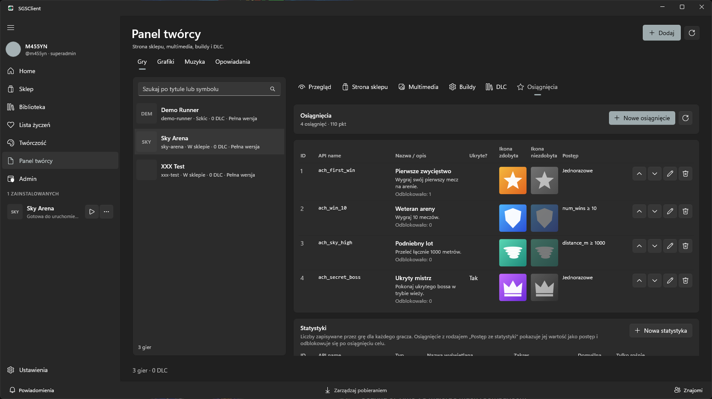
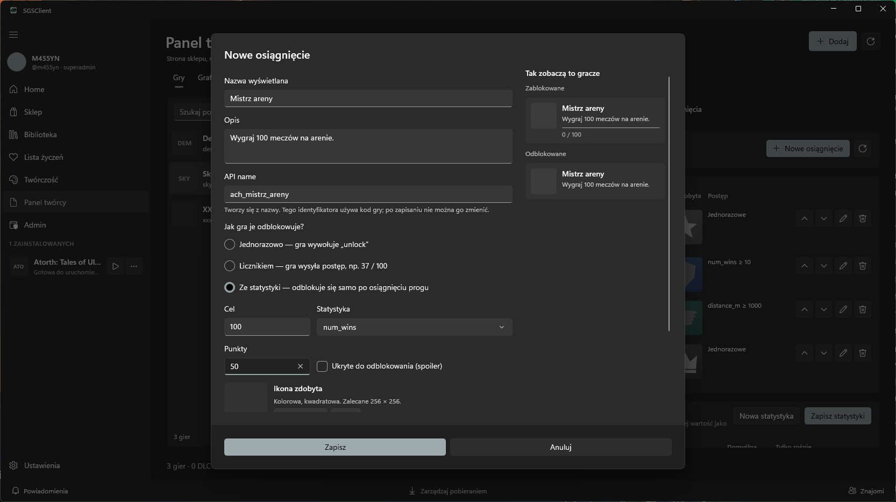
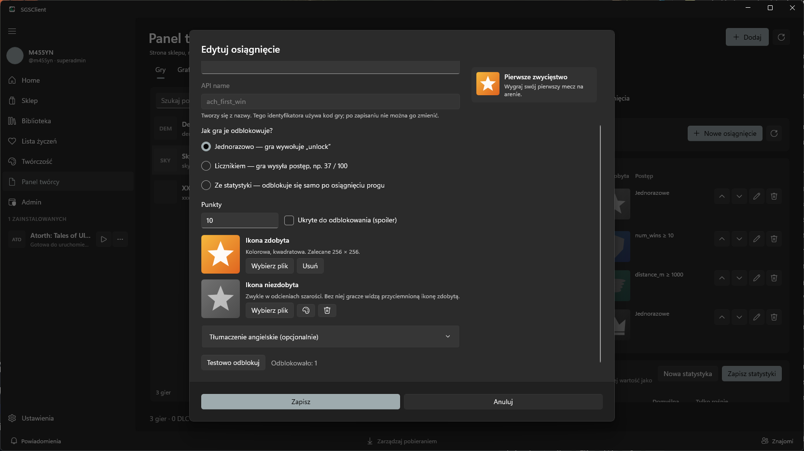
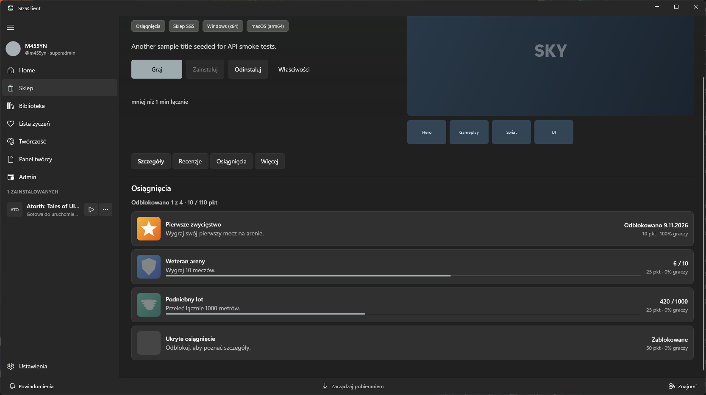
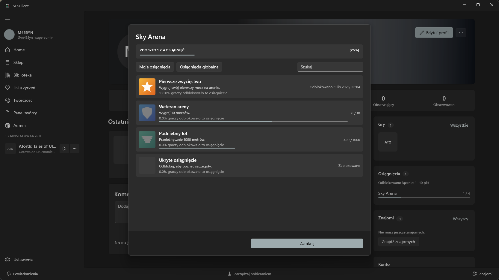
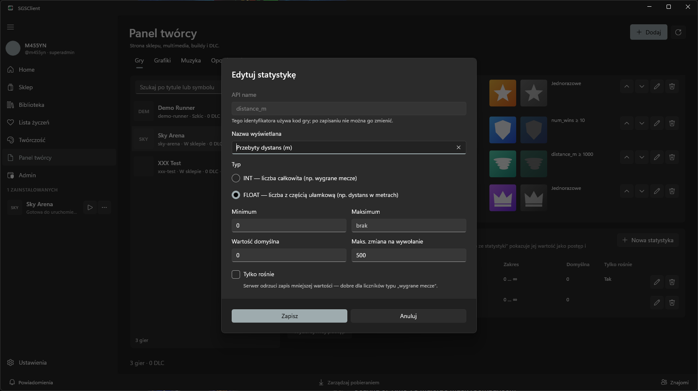

# Osiągnięcia i statystyki

Osiągnięcia w SGS działają jak w Steamworks: każde ma stały **API name**, nazwę i opis, flagę ukrycia, ikonę zdobytą i niezdobytą, a postęp może wynikać ze **statystyki** gracza. Komunikacja to zwykłe HTTP. Każdy silnik, który potrafi wysłać `POST`, może je odblokowywać. Nie potrzebujesz SDK ani natywnej wtyczki.

| Steamworks | SGS |
|---|---|
| API Name (`ACH_WIN_ONE_GAME`) | `key` — wielkość liter bez znaczenia, zapisywany małymi literami |
| Display Name / Description | `title` / `description` (+ `translations`) |
| Hidden (Spoiler) | `hidden` |
| Achieved / Unachieved Icon | `icon` / `lockedIcon` |
| Progress stat + min/max | `stat` + `target` (postęp od 0 do `target`) |
| Stats: INT / FLOAT, min, max, default, max change, increment only | `stats` (bez AVGRATE i statystyk agregowanych) |
| `SetAchievement` / `SetStat` + `StoreStats` | `POST …/unlock` / `POST /api/sdk/stats/{key}` (zapis od razu) |
| `GetAchievementAchievedPercent` | `rarityPercent` w liście osiągnięć |
| `GetAchievementAndUnlockTime` | `unlockedAtUtc` |
| `ResetAllStats(true)` | **Wyzeruj mój postęp** w panelu (Twoje osiągnięcia i statystyki w tej grze) |

## 1. Zdefiniuj osiągnięcia

Masz dwa sposoby. Wybierz ten, który pasuje do Twojego workflow:

- **Panel twórcy** (admini: Panel admina, dowolna gra): wybierz grę → zakładka **Osiągnięcia**. Widok jest tabelą jak w Steamworks (Game Admin → Achievements): kolumny **ID**, **API name**, **Nazwa / opis**, **Ukryte?**, **Ikona zdobyta**, **Ikona niezdobyta**, **Postęp** i w każdym wierszu przyciski: przenieś wyżej / niżej, **Edytuj**, **Usuń**. **Nowe osiągnięcie** i **Edytuj** otwierają okienko; **Zapisz** w okienku od razu zapisuje osiągnięcie na serwerze, a **Anuluj** niczego nie zmienia. Usunięcie i zmiana kolejności też zapisują się od razu (usunięcie po potwierdzeniu). Pod tabelą jest tabela **Statystyki** (**Nowa statystyka**, **Zapisz statystyki**).
- **Manifest paczki** (tablice `achievements` i `stats` w `sgs-manifest.json`): publikowane razem z buildem.



### Okienko osiągnięcia

**Nowe osiągnięcie** i **Edytuj** otwierają okienko z polami:

- **Nazwa wyświetlana** — z niej sam tworzy się **API name** (np. „Pogromca bossa” → `ach_pogromca_bossa`). Możesz go zmienić, dopóki osiągnięcie nie jest zapisane.
- **Jak gra je odblokowuje?** — *Jednorazowo*, *Licznikiem* (pojawia się pole **Cel**) albo *Ze statystyki* (**Cel** + wybór **Statystyki** z listy). Widać tylko pola pasujące do wybranego rodzaju.
- **Ikona zdobyta** / **Ikona niezdobyta** — **Wybierz plik** jak przy multimediach gry. Przycisk ◐ obok ikony niezdobytej robi jej szarą wersję z ikony zdobytej (jak automatyczne ikony w Steam).
- Błędy (pusta nazwa, zajęty API name, brak celu) pokazują się od razu nad formularzem, a **Zapisz** jest wtedy wyłączony.
- Po prawej podgląd „Tak zobaczą to gracze”: wersja zablokowana (z „Ukryte osiągnięcie” dla spoilera i paskiem postępu) i odblokowana.

| Pole | Znaczenie |
|---|---|
| `key` (API name) | Stały identyfikator używany w kodzie gry, np. `ACH_WIN_ONE_GAME` albo `first_boss`. Litery, cyfry, `_` i `-`, do 64 znaków. Wielkość liter nie ma znaczenia (serwer zapisuje małymi literami). **Nie zmieniaj go.** Nowy klucz to nowe osiągnięcie. |
| `title`, `description` | Nazwa wyświetlana i opis (do 128 i 512 znaków). |
| `translations` | `{ "en": { "title": "…", "description": "…" } }`, do 10 kodów języków. Panel edytuje wersję angielską, pozostałe kody są zachowywane. Gracze z danym językiem widzą tłumaczenie, pozostali tekst podstawowy. |
| `icon` | Ikona zdobyta: adres `http(s)`, ścieżka obrazu w ZIP (manifest) albo plik wgrany w panelu (**Edytuj** → **Ikona zdobyta** → **Wybierz plik**, tak jak multimedia gry). Formaty: png, jpg, webp, gif. Kwadratowa, zalecane 256×256 (min. 64×64). |
| `lockedIcon` | Ikona niezdobyta, zwykle w odcieniach szarości. Te same formy co `icon`. Bez niej gracze widzą przyciemnioną ikonę zdobytą. |
| `points` | 0–1000, wartość kosmetyczna. |
| `target` | Brak = odblokowanie jednorazowe. Liczba (2–1 000 000) = licznik albo próg statystyki, po którego osiągnięciu osiągnięcie się odblokowuje. |
| `stat` | API name statystyki, z której wynika postęp (wymaga `target`). Patrz [statystyki](#2-statystyki). |
| `hidden` | Spoiler: nazwa, opis i obie ikony są puste dla graczy do momentu odblokowania. Lista pokazuje wtedy „Ukryte osiągnięcie”. |

Ikony wgrane w panelu i wyciągnięte z ZIP-a leżą przy grze na serwerze, w folderze `<symbol gry>/sdk_sgs/achievements/` (`<api name>.png` i `<api name>_locked.png` dla ikony niezdobytej) i są dostępne pod `/api/games/media/<symbol gry>/sdk_sgs/achievements/<plik>`. Nowe osiągnięcie jest zapisywane automatycznie przy wgrywaniu pierwszej ikony, bo plik nosi nazwę API name.

Kolejność w tabeli (strzałki w formularzu) jest kolejnością, w jakiej gracze widzą osiągnięcia. Na grę przypada do 500 osiągnięć. Usunięcie osiągnięcia tylko je dezaktywuje: gracze zachowują zdobyte, a ponowne dodanie tego samego klucza je przywraca.





### Manifest

```json
"achievements": [
  { "key": "ACH_FIRST_RUN", "title": "Pierwszy bieg", "description": "Ukończ pierwszy poziom.",
    "icon": "media/first_run.png", "lockedIcon": "media/first_run_gray.png", "points": 10,
    "translations": { "en": { "title": "First run", "description": "Finish the first level." } } },
  { "key": "ACH_MARATHON", "title": "Maratończyk", "points": 50, "stat": "DISTANCE_KM", "target": 100 }
],
"stats": [
  { "key": "DISTANCE_KM", "displayName": "Przebiegnięte km", "type": "Float", "minValue": 0, "incrementOnly": true }
]
```

Brak tablicy `achievements` zostawia osiągnięcia i statystyki gry bez zmian. Obecna tablica, nawet pusta, **zastępuje** osiągnięcia przy publikacji, więc manifest wygrywa z Panelem twórcy. `stats` jest czytane tylko razem z `achievements`: obecne zastępuje statystyki, brak zostawia je bez zmian. Każda statystyka użyta w polu `stat` musi być zadeklarowana w `stats` tego samego manifestu.

**Ikony bez wpisywania ścieżek.** Pliki w folderze gry `sdk_sgs/achievements/` są dobierane do osiągnięć po nazwie, gdy osiągnięcie w manifeście nie ma pola `icon` / `lockedIcon`: `sdk_sgs/achievements/<api name>.png` to ikona zdobyta, `<api name>_locked.png` — niezdobyta (dowolny dozwolony format, wielkość liter bez znaczenia, bez podfolderów). Ścieżka podana wprost w manifeście ma pierwszeństwo.

**Pobierz manifest** (Panel twórcy / Admin) zapisuje teraz w `sgs-manifest.json` także `achievements` i `stats` z serwera, a wgrane ikony pobiera obok niego do `sdk_sgs/achievements/`. Ikona, której nie udało się pobrać, zostaje w manifeście jako adres URL. Zapisz manifest w folderze gry i publikuj ten folder — osiągnięcia i ikony pojadą razem z buildem.

Publikacja z formularza (**Opublikuj** / **Opublikuj nową wersję**) zachowuje `achievements` i `stats` z pliku w folderze (wcześniej przepisanie manifestu z formularza je gubiło) i ostrzega, że zastąpią listę z Panelu twórcy. Pełny przykład: [`demo-runner.sgs-manifest.json`](https://github.com/M455YN/SGSClient/blob/master/schemas/examples/demo-runner.sgs-manifest.json).

Flaga funkcji **Osiągnięcia** w sklepie włącza się automatycznie, gdy lista nie jest pusta.

### Testowanie

- **Testowo odblokuj** (w okienku edycji zapisanego osiągnięcia) odblokowuje je na Twoim koncie.
- **Wyzeruj mój postęp** czyści Twoje osiągnięcia i statystyki w tej grze (odpowiednik `ResetAllStats(true)` / `reset_all_stats` w Steam). Postęp innych graczy zostaje.

### Co widzą gracze

Na stronie gry (zakładka **Osiągnięcia**) i w oknie **Pokaż wszystkie osiągnięcia** każde osiągnięcie ma ikonę (niezdobytą lub przyciemnioną, dopóki jest zablokowane), pasek postępu dla liczników i statystyk, datę odblokowania i globalny procent graczy, którzy je zdobyli. Ukryte i niezdobyte pokazują się jako „Ukryte osiągnięcie”. W profilu jest podsumowanie per gra, widoczne dla innych, o ile gracz tego nie ukrył.





## 2. Statystyki

Statystyka to liczba, którą gra zapisuje dla każdego gracza (wygrane gry, przebyty dystans). Osiągnięcie z polem `stat` traktuje jej wartość jako postęp i odblokowuje się samo, gdy wartość dojdzie do `target`. Tak w Steam działają osiągnięcia typu „Wygraj 100 gier”.



| Pole | Znaczenie |
|---|---|
| `key` (API name) | Np. `NUM_GAMES`. Te same zasady co klucz osiągnięcia. |
| `displayName` | Nazwa dla ludzi (do 128 znaków). |
| `type` | `Int` (liczby całkowite) albo `Float`. |
| `minValue`, `maxValue` | Zakres. Brak = bez ograniczenia. |
| `defaultValue` | Wartość, zanim gra cokolwiek zapisze (domyślnie 0). |
| `maxChange` | Największa zmiana w jednym wywołaniu. Brak = bez limitu. |
| `incrementOnly` | Wartość może tylko rosnąć. |

Zapis łamiący którąś z tych zasad jest **odrzucany** (`400`), a nie przycinany — jak `k_EResultInvalidParam` w Steam. Do 100 statystyk na grę. Usunięcie statystyki, której wciąż używa jakieś osiągnięcie, jest blokowane przy zapisie. Postęp osiągnięcia to wartość statystyki zaokrąglona w dół i przycięta do `0…target`; raz zdobyte osiągnięcie zostaje zdobyte, nawet jeśli statystyka później spadnie.

Na osiągnięciu ze statystyką nie da się wywołać `progress` (`400`) — ustaw statystykę. `unlock` działa zawsze.

## 3. Co dostaje gra

Gdy gracz uruchamia grę z klienta SGS, proces dostaje trzy zmienne środowiskowe:

| Zmienna | Przykład | Znaczenie |
|---|---|---|
| `SGS_API_URL` | `http://127.0.0.1:51234` | Adres **lokalnego mostu SGS** (tylko pętla zwrotna) |
| `SGS_GAME_ID` | `12` | Id Twojej gry |
| `SGS_ACHIEVEMENTS_TOKEN` | `3f9a…` | Losowy token na jedno uruchomienie, akceptowany tylko przez most |

Most podpisuje wywołania logowaniem gracza, więc token nie wygasa w długiej sesji. Gdy gracz jest **offline**, most **kolejkuje wywołania** i odtwarza je później. Kolejka przeżywa restart klienta. Jeśli zmiennych nie ma (gra uruchomiona poza SGS), pomiń osiągnięcia. Gra ma działać dalej.

Token wysyłaj w nagłówku `X-SGS-Token`.

## 4. Endpointy

Wszystkie wywołania są względne do `SGS_API_URL`. Most odpowiada na zapytania CORS preflight, więc działają też buildy HTML5 i WebGL.

| Wywołanie | Cel |
|---|---|
| `POST /api/sdk/achievements/{key}/unlock` | Odblokowanie osiągnięcia jednorazowego (lub wypełnienie licznika). Można powtarzać bezpiecznie. |
| `POST /api/sdk/achievements/{key}/progress` z `{"value": 37}` | Ustawienie licznika na wartość bezwzględną. Nigdy nie spada i jest ograniczony do celu. Osiągnięcie celu je odblokowuje. |
| `POST /api/sdk/stats/{key}` z `{"value": 12}` | Ustawienie statystyki na wartość bezwzględną (jak `SetStat`). Przesuwa postęp powiązanych osiągnięć i odblokowuje te, których próg osiągnięto. |
| `GET /api/sdk/achievements?lang=pl` | Definicje oraz postęp gracza, czas odblokowania, rzadkość i aktualne wartości statystyk (`stats`) — odpowiednik `RequestCurrentStats` + `GetStat` (wymaga połączenia). |

Wywołania `unlock` i `progress` zwracają:

```json
{ "key": "kills", "progress": 40, "target": 100, "unlocked": false, "justUnlocked": false }
```

Wywołanie statystyki zwraca jej wartość i wynik dla każdego powiązanego osiągnięcia:

```json
{ "key": "num_games", "value": 12,
  "achievements": [ { "key": "ach_win_10", "progress": 10, "target": 10, "unlocked": true, "justUnlocked": true } ] }
```

`justUnlocked` ma wartość `true` tylko dla wywołania, które faktycznie odblokowało osiągnięcie. Wtedy pokaż własny komunikat. Gracz dostaje też powiadomienie w kliencie SGS.

Gdy gracz jest offline, most odpowiada `202` w tym samym kształcie z polem `"queued": true`. Traktuj to jak sukces. Odblokowanie dotrze do serwera później, a powiadomienie przyjdzie wtedy.

| Kod | Znaczenie |
|---|---|
| `200` | OK |
| `202` | Przyjęte do kolejki offline |
| `400` | Błędne dane, np. `progress` na osiągnięciu jednorazowym albo statystyka poza zakresem / malejąca przy `incrementOnly` |
| `401` | Brak lub błędny token |
| `403` | Gracz nie ma gry w bibliotece |
| `404` | Nieznany lub nieaktywny klucz osiągnięcia lub statystyki |
| `503` | `GET` bez sieci lub bez logowania |

Serwer przycina klucze i zamienia je na małe litery, więc `ACH_WIN_ONE_GAME` i `ach_win_one_game` to to samo osiągnięcie.

## 5. Przykłady

### curl

```bash
curl -X POST "$SGS_API_URL/api/sdk/achievements/first_boss/unlock" \
     -H "X-SGS-Token: $SGS_ACHIEVEMENTS_TOKEN"

curl -X POST "$SGS_API_URL/api/sdk/achievements/kills/progress" \
     -H "X-SGS-Token: $SGS_ACHIEVEMENTS_TOKEN" \
     -H "Content-Type: application/json" -d '{"value": 40}'

curl -X POST "$SGS_API_URL/api/sdk/stats/NUM_GAMES" \
     -H "X-SGS-Token: $SGS_ACHIEVEMENTS_TOKEN" \
     -H "Content-Type: application/json" -d '{"value": 12}'
```

### Unity (C#)

```csharp
using System.Collections;
using UnityEngine;
using UnityEngine.Networking;

public static class Sgs
{
    public static IEnumerator Unlock(string key)
    {
        var url = System.Environment.GetEnvironmentVariable("SGS_API_URL");
        var token = System.Environment.GetEnvironmentVariable("SGS_ACHIEVEMENTS_TOKEN");
        if (string.IsNullOrEmpty(url) || string.IsNullOrEmpty(token)) yield break;

        using var request = new UnityWebRequest($"{url}/api/sdk/achievements/{key}/unlock", "POST");
        request.downloadHandler = new DownloadHandlerBuffer();
        request.SetRequestHeader("X-SGS-Token", token);
        yield return request.SendWebRequest();
    }

    public static IEnumerator SetStat(string key, float value)
    {
        var url = System.Environment.GetEnvironmentVariable("SGS_API_URL");
        var token = System.Environment.GetEnvironmentVariable("SGS_ACHIEVEMENTS_TOKEN");
        if (string.IsNullOrEmpty(url) || string.IsNullOrEmpty(token)) yield break;

        var body = System.Text.Encoding.UTF8.GetBytes(
            "{\"value\":" + value.ToString(System.Globalization.CultureInfo.InvariantCulture) + "}");
        using var request = new UnityWebRequest($"{url}/api/sdk/stats/{key}", "POST");
        request.uploadHandler = new UploadHandlerRaw(body);
        request.downloadHandler = new DownloadHandlerBuffer();
        request.SetRequestHeader("X-SGS-Token", token);
        request.SetRequestHeader("Content-Type", "application/json");
        yield return request.SendWebRequest();
    }
}
// StartCoroutine(Sgs.Unlock("ACH_WIN_ONE_GAME"));
// StartCoroutine(Sgs.SetStat("NUM_GAMES", gamesWon));
```

### Godot 4 (GDScript)

```gdscript
func sgs_unlock(key: String) -> void:
    var url := OS.get_environment("SGS_API_URL")
    var token := OS.get_environment("SGS_ACHIEVEMENTS_TOKEN")
    if url.is_empty() or token.is_empty():
        return
    var http := HTTPRequest.new()
    add_child(http)
    http.request_completed.connect(func(_r, _c, _h, _b): http.queue_free())
    http.request(url + "/api/sdk/achievements/" + key + "/unlock",
        ["X-SGS-Token: " + token], HTTPClient.METHOD_POST)

func sgs_set_stat(key: String, value: float) -> void:
    var url := OS.get_environment("SGS_API_URL")
    var token := OS.get_environment("SGS_ACHIEVEMENTS_TOKEN")
    if url.is_empty() or token.is_empty():
        return
    var http := HTTPRequest.new()
    add_child(http)
    http.request_completed.connect(func(_r, _c, _h, _b): http.queue_free())
    http.request(url + "/api/sdk/stats/" + key,
        ["X-SGS-Token: " + token, "Content-Type: application/json"],
        HTTPClient.METHOD_POST, JSON.stringify({"value": value}))
```

### Unreal (C++)

```cpp
#include "HttpModule.h"
#include "Interfaces/IHttpRequest.h"
#include "HAL/PlatformMisc.h"

void SgsUnlock(const FString& Key)
{
    const FString Url = FPlatformMisc::GetEnvironmentVariable(TEXT("SGS_API_URL"));
    const FString Token = FPlatformMisc::GetEnvironmentVariable(TEXT("SGS_ACHIEVEMENTS_TOKEN"));
    if (Url.IsEmpty() || Token.IsEmpty()) return;

    auto Request = FHttpModule::Get().CreateRequest();
    Request->SetURL(Url + TEXT("/api/sdk/achievements/") + Key + TEXT("/unlock"));
    Request->SetVerb(TEXT("POST"));
    Request->SetHeader(TEXT("X-SGS-Token"), Token);
    Request->ProcessRequest();
}
```

Statystyka w Unrealu (wartość bezwzględna, jak `SetStat`):

```cpp
void SgsSetStat(const FString& Key, double Value)
{
    const FString Url = FPlatformMisc::GetEnvironmentVariable(TEXT("SGS_API_URL"));
    const FString Token = FPlatformMisc::GetEnvironmentVariable(TEXT("SGS_ACHIEVEMENTS_TOKEN"));
    if (Url.IsEmpty() || Token.IsEmpty()) return;

    auto Request = FHttpModule::Get().CreateRequest();
    Request->SetURL(Url + TEXT("/api/sdk/stats/") + Key);
    Request->SetVerb(TEXT("POST"));
    Request->SetHeader(TEXT("X-SGS-Token"), Token);
    Request->SetHeader(TEXT("Content-Type"), TEXT("application/json"));
    // SanitizeFloat always writes a dot, whatever the player's locale.
    Request->SetContentAsString(FString::Printf(TEXT("{\"value\":%s}"), *FString::SanitizeFloat(Value)));
    Request->ProcessRequest();
}
// SgsSetStat(TEXT("NUM_GAMES"), GamesWon);
```

Każdy inny silnik działa tak samo: odczytaj dwie zmienne, ustaw nagłówek i wyślij `POST`.

### Pełny przykład: wygrane mecze → statystyka → osiągnięcie

W Panelu twórcy są zdefiniowane:

- statystyka `NUM_GAMES` (INT, minimum 0, **tylko rośnie**),
- osiągnięcie `ACH_WIN_10` „Weteran areny”, rodzaj **Ze statystyki**, statystyka `num_games`, cel 10.

Gra nie odblokowuje `ACH_WIN_10` sama. Po każdej wygranej wysyła nową wartość `NUM_GAMES`, a serwer przesuwa pasek postępu (6 / 10) i przy 10 odblokowuje osiągnięcie. Wartość jest **bezwzględna**, więc na starcie gra odczytuje zapisaną liczbę (odpowiednik `RequestCurrentStats` + `GetStat` w Steam), a potem wysyła `+1`.

```csharp
using System;
using System.Collections;
using System.Globalization;
using System.Linq;
using System.Text;
using UnityEngine;
using UnityEngine.Networking;

public class SgsStats : MonoBehaviour
{
    // Pola nazwane jak w JSON-ie z API (camelCase); reszta odpowiedzi jest pomijana.
    [Serializable] class StatValue { public string key; public float value; }
    [Serializable] class GameAchievements { public StatValue[] stats; }
    [Serializable] class AchievementResult { public string key; public int progress; public bool unlocked; public bool justUnlocked; }
    [Serializable] class StatResult { public string key; public float value; public AchievementResult[] achievements; }

    string _url, _token;
    int _gamesWon;

    IEnumerator Start()
    {
        _url = Environment.GetEnvironmentVariable("SGS_API_URL");
        _token = Environment.GetEnvironmentVariable("SGS_ACHIEVEMENTS_TOKEN");
        _gamesWon = PlayerPrefs.GetInt("num_games"); // lokalna kopia na wypadek grania offline
        if (string.IsNullOrEmpty(_url) || string.IsNullOrEmpty(_token)) yield break; // gra uruchomiona poza SGS

        using var get = UnityWebRequest.Get($"{_url}/api/sdk/achievements");
        get.SetRequestHeader("X-SGS-Token", _token);
        yield return get.SendWebRequest();
        if (get.result != UnityWebRequest.Result.Success) yield break; // 503 = offline, gramy dalej na kopii lokalnej

        // Serwer zwraca API name małymi literami.
        var stored = JsonUtility.FromJson<GameAchievements>(get.downloadHandler.text)
            .stats?.FirstOrDefault(s => s.key == "num_games")?.value ?? 0;
        _gamesWon = Math.Max(_gamesWon, (int)stored); // "tylko rośnie" odrzuciłoby mniejszą wartość
    }

    // Wywołaj po wygranym meczu.
    public void OnMatchWon()
    {
        _gamesWon++;
        PlayerPrefs.SetInt("num_games", _gamesWon);
        StartCoroutine(SetStat("NUM_GAMES", _gamesWon));
    }

    IEnumerator SetStat(string key, float value)
    {
        if (string.IsNullOrEmpty(_url) || string.IsNullOrEmpty(_token)) yield break;

        var body = "{\"value\":" + value.ToString(CultureInfo.InvariantCulture) + "}";
        using var post = new UnityWebRequest($"{_url}/api/sdk/stats/{key}", "POST");
        post.uploadHandler = new UploadHandlerRaw(Encoding.UTF8.GetBytes(body));
        post.downloadHandler = new DownloadHandlerBuffer();
        post.SetRequestHeader("X-SGS-Token", _token);
        post.SetRequestHeader("Content-Type", "application/json");
        yield return post.SendWebRequest();

        // 202 = klient SGS zakolejkował wywołanie offline; odblokowanie przyjdzie później jako powiadomienie.
        if (post.responseCode != 200) yield break;

        var result = JsonUtility.FromJson<StatResult>(post.downloadHandler.text);
        foreach (var achievement in result.achievements ?? Array.Empty<AchievementResult>())
        {
            if (achievement.justUnlocked)
            {
                Debug.Log($"Odblokowano osiągnięcie {achievement.key}"); // tu pokaż własny komunikat w grze
            }
        }
    }
}
```

Odpowiedź na `POST /api/sdk/stats/NUM_GAMES` z `{"value": 10}`:

```json
{ "key": "num_games", "value": 10,
  "achievements": [ { "key": "ach_win_10", "progress": 10, "target": 10, "unlocked": true, "justUnlocked": true } ] }
```

Gdy postęp nie wynika z żadnej statystyki (np. „Przeleć 1000 m” liczone tylko na potrzeby osiągnięcia), wybierz rodzaj **Licznikiem** i wysyłaj `POST /api/sdk/achievements/ACH_SKY_HIGH/progress` z `{"value": 420}`. Ten sam kod z adresem `.../achievements/{key}/progress` zamiast `.../stats/{key}`; odpowiedź ma wtedy kształt z punktu 4 (`progress`, `target`, `justUnlocked`). Statystyka jest lepsza, gdy z jednej liczby korzysta kilka osiągnięć (10, 50 i 100 wygranych) albo sama gra chce ją pokazać graczowi.

## 6. Bez klienta SGS

Inny launcher albo serwer może wołać API bezpośrednio. Wywołaj `POST /api/me/games/{id}/achievements/session` z tokenem logowania gracza. Dostaniesz krótkotrwały token gry (12 h). Potem używasz ścieżek `api/sdk/achievements` i `api/sdk/stats` na hoście API z nagłówkiem `X-SGS-Token`. W tym trybie nie ma kolejki offline.

Host API potrzebuje `Achievements:SigningKey` (zmienna `Achievements__SigningKey`, 32 lub więcej losowych znaków), żeby podpisywać te tokeny. Bez niego serwer generuje losowy klucz przy każdym starcie, więc tokeny przestają działać po restarcie i przy kilku instancjach API. Klient SGS tego klucza nie potrzebuje.

## Ograniczenia

- Kod gry działa na komputerze gracza, więc osiągnięć nie da się zabezpieczyć przed ingerencją. Traktuj je jako element kosmetyczny.
- Kolejka jest odtwarzana, gdy klient działa i gracz jest zalogowany. Wywołania innego konta czekają, aż to konto się zaloguje. Dla statystyki kolejka trzyma tylko ostatnią wartość.
- W odróżnieniu od Steam nie ma typu AVGRATE, statystyk agregowanych globalnie ani zestawów osiągnięć (achievement sets).
- Gracz może ukryć swoje osiągnięcia przed innymi w **Profil → Dostosuj profil → Prywatność**. Ukryta lista jest pusta dla wszystkich poza właścicielem. Rzadkość per gra pozostaje zagregowana i anonimowa.
