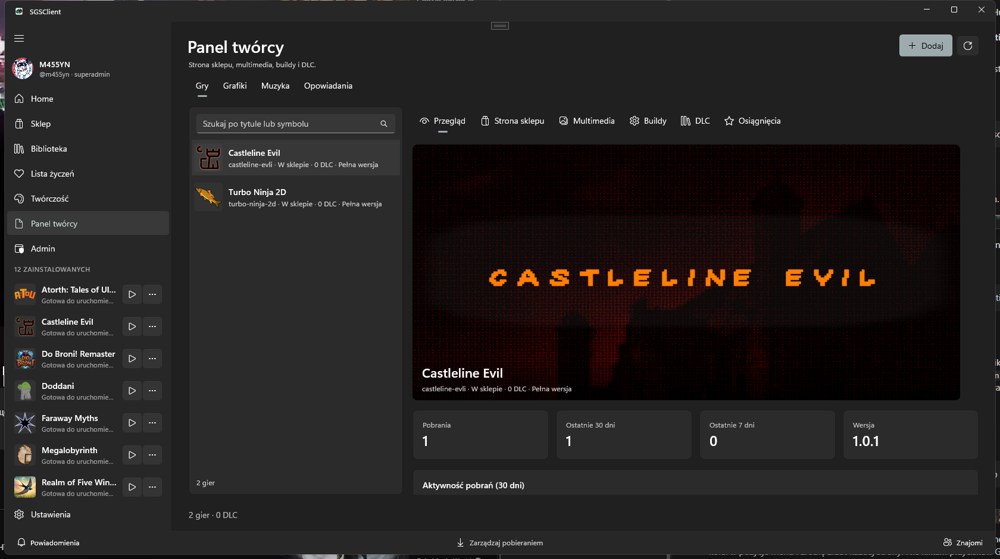

# Jak opublikować grę

Potrzebujesz konta z rolą **Twórca** (lub wyższą). W kliencie wejdź w **Panel twórcy**. Stamtąd publikujesz pierwszą wersję i kolejne buildy. Osobna pozycja **Publikuj** w menu jest ukryta.



## 1. Przygotuj folder gry

Umieść pliki gry i manifest w **korzeniu** folderu. Ten sam układ trafia do ZIP:

```text
moja-gra/
  sgs-manifest.json
  bin/MojaGra.exe
  data/...
  media/cover.png
  media/header.png
```

Nazwy plików mediów mogą być inne, byle ścieżki w manifeście się zgadzały. Ścieżki mają być względne, z ukośnikiem `/`, bez `..`.

## 2. Wypełnij `sgs-manifest.json`

Wymagane pola: `schemaVersion` (obecnie `1`), `game.title`, `game.symbol`, `build.version`, `build.platform`, `build.executable`.

```json
{
  "schemaVersion": 1,
  "game": {
    "title": "Moja gra",
    "symbol": "moja-gra",
    "kind": "game",
    "description": "Krótki opis na stronę sklepu.",
    "genre": "indie",
    "engine": "unity",
    "studioName": "Moje studio",
    "websiteUrl": "https://example.com",
    "discordUrl": "https://discord.gg/example",
    "supportUrl": "https://example.com/support",
    "releaseStatus": "released",
    "releaseDate": "2024-06-15",
    "ageRating": "pegi12",
    "features": ["singleplayer", "controller"],
    "languages": ["Polski", "English"],
    "tags": ["roguelike", "pixel art"],
    "media": {
      "cover": "media/cover.png",
      "header": "media/header.png",
      "logo": "media/logo.png",
      "intro": "media/intro.mp4",
      "screenshots": [
        "media/screen-01.png",
        "media/screen-02.png"
      ]
    }
  },
  "build": {
    "version": "1.0.0",
    "platform": "windows",
    "architecture": "x64",
    "executable": "bin/MojaGra.exe",
    "isDefault": true
  }
}
```

| Pole | Zasada |
|------|--------|
| `symbol` | Stały slug w stylu kebab-case: `a-z`, `0-9`, myślniki; 2–64 znaki. Nie zmieniaj go po pierwszej publikacji. |
| `kind` | `game` albo `dlc`. DLC wymaga `parentSymbol` gry bazowej. |
| `version` | SemVer, np. `1.0.0` lub `1.0.0-beta.1` |
| `platform` | `windows`, `linux`, `macos` |
| `architecture` | `x64`, `x86`, `arm64` |
| `executable` | Plik startowy w ZIP; na Windowsie zwykle `.exe` |
| `genre` | `action`, `adventure`, `rpg`, `strategy`, `simulation`, `sports`, `racing`, `puzzle`, `horror`, `indie`, `platformer`, `shooter`, `fps`, `tps`, `fighting`, `stealth`, `survival`, `sandbox`, `open-world`, `roguelike`, `roguelite`, `metroidvania`, `visual-novel`, `card`, `turn-based`, `mmo`, `moba`, `battle-royale`, `tower-defense`, `idle`, `casual`, `party`, `rhythm`, `educational`, `narrative`, `walking-sim`, `vr`, `other` |
| `engine` | `unity`, `unreal`, `godot`, `cryengine`, `gamemaker`, `construct`, `rpgmaker`, `renpy`, `defold`, `monogame`, `fna`, `stride`, `bevy`, `libgdx`, `love2d`, `phaser`, `cocos`, `solar2d`, `clickteam-fusion`, `source`, `source2`, `idtech`, `frostbite`, `creation-engine`, `red-engine`, `anvil`, `snowdrop`, `o3de`, `raylib`, `pygame`, `sdl`, `html5`, `roblox`, `custom`, `other` |
| `studioName`, `websiteUrl`, `discordUrl`, `supportUrl` | Opcjonalne linki do sklepu (muszą zaczynać się od `http://` lub `https://`) |
| `releaseStatus` | `announced`, `earlyAccess`, `released`, `demo` |
| `releaseDate` | Data ISO, np. `2024-06-15` |
| `ageRating` | `unrated`, `pegi3`, `pegi7`, `pegi12`, `pegi16`, `pegi18` |
| `features` | `singleplayer`, `multiplayer`, `coop`, `controller`, `cloud`, `achievements`, `modding`, `vr` (`achievements` ustawia się też automatycznie po zdefiniowaniu osiągnięć, patrz [Osiągnięcia](achievements.md)) |
| `languages`, `tags` | Tablice tekstów (te same pola co w Panelu twórcy) |

Media są opcjonalne przy wysyłce. Możesz dodać je później w **Panel twórcy → Multimedia**. Wymiary znajdziesz w [Grafice sklepowej](store-art.md).

Przy nowej wersji istniejącej gry grafiki zostają, dopóki paczka ich nie zastąpi. Okładka, nagłówek, logo i intro są nadpisywane tylko wtedy, gdy są w manifeście. Zrzuty ekranu są podmieniane tylko wtedy, gdy manifest zawiera co najmniej jeden. Wtedy cały zestaw jest wymieniany.

Nie musisz przepisywać manifestu przy każdej wersji. Przycisk **Pobierz manifest** w **Panelu twórcy** lub w **Adminie** zapisuje `sgs-manifest.json` zbudowany z opublikowanej gry: dane, gatunki, tagi, obecną wersję i exe. Bez multimediów i osiągnięć. **Opublikuj nową wersję** też wypełnia formularz z opublikowanej gry, gdy wybrany folder nie ma manifestu. Wpisujesz tylko numer nowej wersji i opis zmian.

Pełny przykład manifestu: [`demo-runner.sgs-manifest.json`](https://github.com/M455YN/SGSClient/blob/master/schemas/examples/demo-runner.sgs-manifest.json).

Gotowy folder i ZIP jako szablon (atrapa exe i opisane grafiki): [`sample-game/`](https://github.com/M455YN/SGSClient/tree/master/schemas/examples/sample-game) i [`sample-game-package.zip`](https://github.com/M455YN/SGSClient/blob/master/schemas/examples/sample-game-package.zip).

## 3. Wyślij z klienta

1. Zaloguj się w **Profilu**.
2. Otwórz **Panel twórcy** i wybierz nową grę albo nową wersję.
3. Wskaż folder, w którym leży `sgs-manifest.json`.
4. Sprawdź tytuł, symbol, multimedia i ścieżkę exe.
5. Spakuj i wyślij.

Klient buduje ZIP i wysyła go na `POST /api/Games/uploads`. Serwer sprawdza manifest jeszcze raz.

Nowa gra zaczyna jako **szkic** i nie jest widoczna w sklepie. W przeglądzie Panelu twórcy włącz **W sklepie**, gdy strona i grafika są gotowe.

## Limity paczki (v1)

| Limit | Wartość |
|-------|---------|
| ZIP | 2 GB |
| Rozpakowane | 4 GB |
| Liczba plików w archiwum | 20 000 |
| Głębokość ścieżki | 12 |
| Jeden plik multimedialny | 80 MB |
| Zrzuty ekranu | 12 |

Serwer odrzuca ścieżki bezwzględne, ścieżki z `..` oraz exe niezgodne z platformą.
