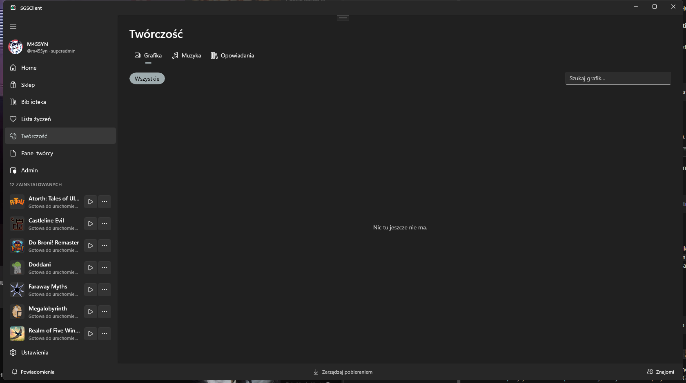

# Twórczość: grafika, muzyka, opowiadania

Sekcja **Twórczość** to miejsce na prace, które nie są grami: grafiki, utwory muzyczne i opowiadania. Każdy zalogowany użytkownik może publikować własne prace i komentować cudze. Publikowanie gier to osobna ścieżka: [Publikowanie gier](../creators/how-to-publish.md).

## Co możesz dodać

| Typ | Pliki | Limit pliku | Dodatkowo |
|---|---|---|---|
| **Grafika** | PNG, JPG, JPEG, WEBP, GIF | 25 MB | tytuł, opis, tagi |
| **Muzyka** | MP3, FLAC, WAV, OGG, M4A | 100 MB | okładka: PNG, JPG, JPEG, WEBP, do 10 MB |
| **Opowiadania** | tekst w rozdziałach | 200 rozdziałów | okładka, tytuł każdego rozdziału |

Wspólne limity:

- tytuł: do 120 znaków
- opis: do 4000 znaków
- tagi: do 10, każdy do 30 znaków
- rozdział opowiadania: tytuł do 200 znaków, treść do 200 000 znaków
- komentarz: do 2000 znaków

## Dodawanie pracy

1. Przejdź do **Twórczość** i wybierz zakładkę: **Grafika**, **Muzyka** lub **Opowiadania**.
2. Kliknij **Dodaj grafikę**, **Dodaj muzykę** albo **Dodaj opowiadanie**.
3. Wypełnij tytuł, opis i tagi, dodaj plik (lub rozdziały, przy opowiadaniu).
4. Zapisz. Praca pojawia się na liście i na Twojej stronie.

Dodałeś błędny plik albo literówkę? Edytuj pracę, zamiast dodawać ją drugi raz.

## Komentarze i usuwanie

Pod pracą można komentować. Możesz usunąć swój komentarz i swoją pracę. Administrator może usuwać cudze treści, które łamią regulamin.

## Dobre praktyki

- Publikuj tylko prace, do których masz prawa. Muzykę i grafikę cudzego autorstwa zgłaszaj tylko z licencją na udostępnianie.
- Nie wrzucaj danych osobowych w opisach ani w plikach.
