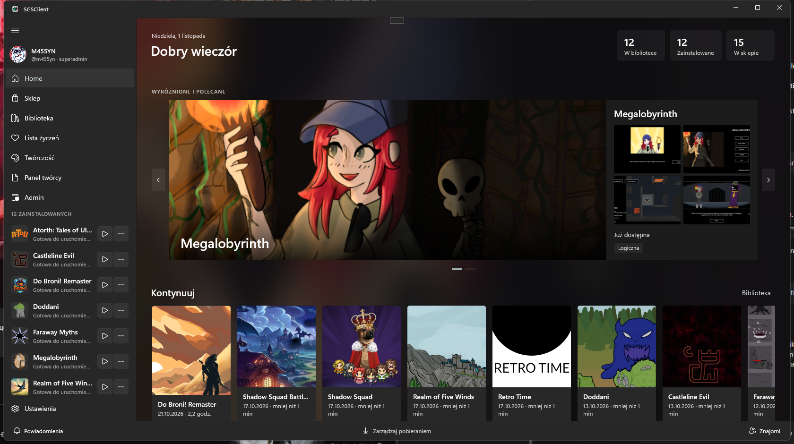

# Pierwsze kroki

SGS to sklep i biblioteka gier dla klienta desktopowego (Windows, Linux, macOS). Ta strona prowadzi od instalacji do pierwszej uruchomionej gry.

## 1. Zainstaluj klienta

Pobierz paczkę klienta od organizatora platformy lub z własnego serwera. Klient łączy się z API sklepu, którego adres jest ustawiony w konfiguracji. Jeśli Twój klient nie widzi sklepu, sprawdź w **Ustawienia → Konto i sklep → Serwer sklepu**.

## 2. Zaloguj się

Otwórz **Profil** w lewym menu i wybierz **Zaloguj się**. Logowanie odbywa się przez Azure AD B2C, a klient nie przechowuje hasła. Po zalogowaniu Twój profil pojawia się w menu.

Bez logowania możesz przeglądać **Sklep**, ale nie kupisz gier, nie dodasz znajomych i nie zapiszesz osiągnięć.

## 3. Wybierz gry

W **Sklepie** otwórz stronę gry i dodaj ją do biblioteki (**Dodaj do biblioteki**) albo na **Listę życzeń**. Szczegóły: [Sklep, biblioteka i pobieranie](store-and-library.md).

## 4. Zainstaluj i zagraj

Na stronie gry albo w **Bibliotece** wybierz **Zainstaluj** (przy wielu wersjach wybierz tę, którą chcesz pobrać; domyślnie zaznaczona jest najnowsza). Po instalacji przycisk zmienia się w **Graj**. Postęp widzisz w **Pobraniach**.

## Gdzie co jest

| Pozycja w menu | Co tam jest |
|---|---|
| **Home** | Start: sekcje **Kontynuuj**, **Nowe w sklepie**, **Wyróżnione** i **Gotowe do instalacji** |
| **Sklep** | Katalog gier, filtry, strony gier |
| **Biblioteka** | Gry, które masz, instalacja, uruchamianie |
| **Pobrania** | Trwające i zakończone instalacje |
| **Lista życzeń** | Gry, które chcesz kupić później |
| **Znajomi** | Znajomi, zaproszenia, czat |
| **Twórczość** | Grafiki, muzyka i opowiadania innych użytkowników |
| **Publikuj** / **Panel twórcy** | Dla kont z rolą Twórca i wyższą: [Publikowanie gier](../creators/how-to-publish.md) |
| **Ustawienia** | Wygląd, język, foldery bibliotek, konto, wersja |

Pozycje **Publikuj** i **Panel twórcy** są widoczne tylko dla kont z uprawnieniem do publikowania.

## Jeśli coś nie działa

- **Sklep niedostępny** — klient nie łączy się z API. Sprawdź połączenie i adres serwera w Ustawieniach.
- **Gra nie startuje** — sprawdź, czy instalacja zakończyła się w **Pobraniach**. Spróbuj ponownie zainstalować grę.
- **Brak powiadomień od znajomych** — upewnij się, że jesteś zalogowany. Powiadomienia wymagają połączenia z API.
