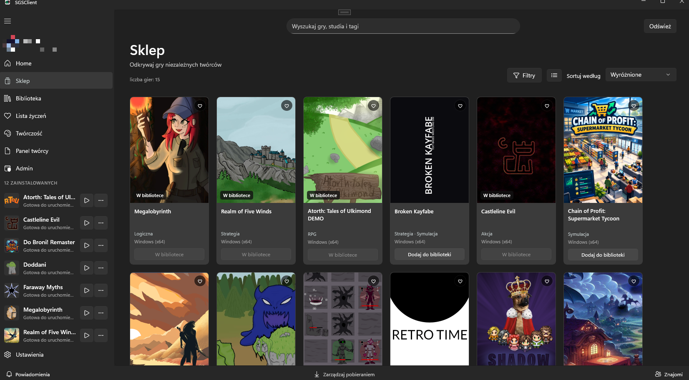
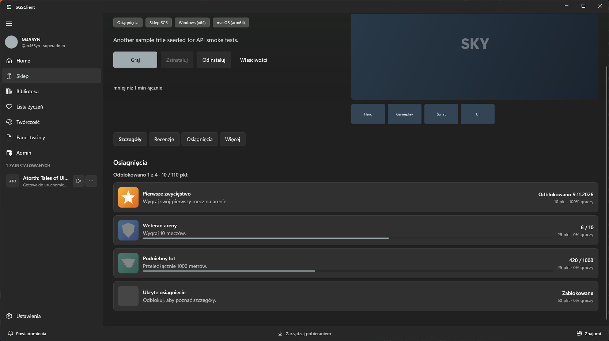
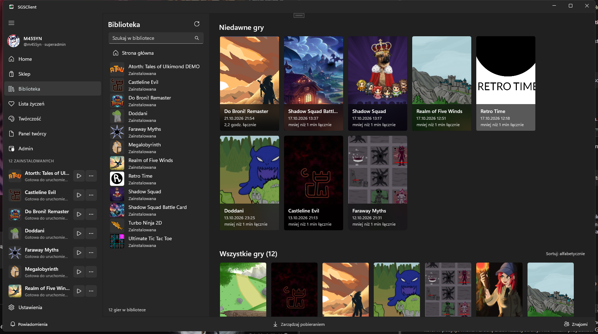
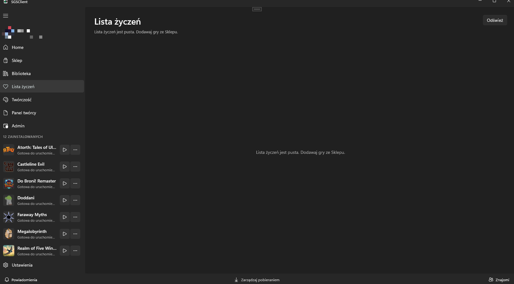

# Sklep, biblioteka i pobieranie

## Sklep

W **Sklepie** przeglądasz katalog. Możesz szukać po nazwie, studiu lub tagu (**Wyszukaj gry, studia i tagi**), filtrować (**Filtry**) i sortować (**Sortuj według**).

Strona gry zawiera:

- **Opis** i **Szczegóły**: gatunek, silnik, platforma, etap premiery, wersja, typ treści
- **Wymagania sprzętowe**, jeśli twórca je podał
- **Osiągnięcia**, jeśli gra je ma: ikona (szara albo przyciemniona, dopóki osiągnięcie jest zablokowane), pasek postępu dla liczników, data odblokowania i procent graczy, którzy je zdobyli. Ukryte osiągnięcia pokazują się jako „Ukryte osiągnięcie”, dopóki ich nie odblokujesz (patrz też [Znajomi, czat i profil](social.md))
- **Recenzje**: polecasz lub nie polecasz (**Polecam** / **Nie polecam**) i piszesz recenzję. Żeby napisać recenzję, musisz mieć grę w bibliotece. Treść recenzji ma co najmniej 10 znaków.
- **Dodaj do biblioteki** albo **Lista życzeń**

## Biblioteka

**Biblioteka** pokazuje gry, które masz.

Gra może być:

- **w bibliotece, niezainstalowana** — kliknij **Zainstaluj**
- **zainstalowana** — kliknij **Graj**
- **z dostępną aktualizacją** — kliknij **Aktualizuj**

Na stronie zainstalowanej gry jest **Odinstaluj**. Usuwa pliki gry z dysku; gra zostaje w bibliotece i możesz ją zainstalować ponownie.

### Foldery bibliotek

Gry instalują się w folderze bibliotek. Dodaj inny dysk w **Ustawienia → Biblioteka → Dodaj folder…**. Jeśli przeniosłeś gry ręcznie, użyj **Skanuj ponownie**, żeby klient je odnalazł. **Usuń z listy** usuwa folder z listy klienta, nie z dysku.

## Pobrania

**Pobrania** pokazuje trwające instalacje i ich postęp. Jeśli instalacja się nie uda, spróbuj ponownie z tej listy.

## Lista życzeń

Dodawaj gry ze **Sklepu** do **Listy życzeń**. Osobna pozycja w menu pokazuje wszystkie zapisane gry.

## Czas gry

Na stronie zainstalowanej gry widać, ile czasu w niej spędziłeś.

## Uruchamianie gier

Gra startuje jako osobny proces. Klient przekazuje jej dane łączności z SGS (patrz [Integracja z SGS](../developers/bridge.md)). Osiągnięcia i postęp wysyłane przez grę są kolejkowane, gdy jesteś offline, i trafiają na serwer po powrocie do sieci, nawet po restarcie klienta.
